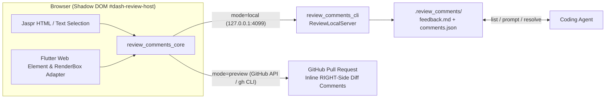

# review_comments

Vercel-style visual highlight, local coding-agent feedback sync, and staged
GitHub PR inline diff comments for **Jaspr** (`jaspr` / `jaspr_content`) and
**Flutter Web** applications.

Highlight rendered prose, click any DOM element or live Flutter widget
(`Alt+C`), or drag an area box directly in your browser to anchor feedback to
the exact repository source file and line numbers.

- **Local Review Mode (`REVIEW_COMMENTS_MODE=local`)**: Syncs highlights and
  comments atomically to `.review_comments/comments.json` and an agent-ready
  `.review_comments/feedback.md` via a loopback-only `127.0.0.1` server, with
  full CLI commands (`list`, `prompt`, `resolve`, `clear`) for Claude Code,
  Gemini / Jetski, Cursor, and terminal agents.
- **Staged PR Preview Mode (`REVIEW_COMMENTS_MODE=preview`)**: Maps visual
  highlights on Firebase Hosting or static PR preview deployments back to
  unified diff `RIGHT`-side lines (`POST /repos/{owner}/{repo}/pulls/{pr}/comments`),
  hydrates existing PR comments back onto the live preview as numbered pins,
  and provides a zero-token 1-click `gh` CLI copy fallback.
- **Zero Production Overhead**: Hard-gated by `PRODUCTION=true` and explicit
  mode checks so standard `flutter build web` and `jaspr build` production
  bundles emit **zero** review overlay bytes.

---

## Architecture & Packages (1 Package Per Project)

You only ever add **one package** and **one import** to your app:

- **In a Jaspr / `jaspr_content` project:** add `review_comments_jaspr`
- **In a Flutter Web project:** add `review_comments_flutter`

| Package | Description |
| :--- | :--- |
| [`packages/review_comments_jaspr`](packages/review_comments_jaspr) | **Single-package Jaspr plugin**: `ReviewCommentsOverlay`, `ReviewCommentsPageExtension`, `registerReviewLocalProxyMiddleware()`, `buildReviewOverlayComponents`, and bundled `review_comments` CLI. |
| [`packages/review_comments_flutter`](packages/review_comments_flutter) | **Single-package Flutter Web plugin**: `ReviewCommentsOverlay` + `ReviewCommentsNavigatorObserver` bridging `<flutter-view>` (CanvasKit / Skwasm) `Element`, `RenderBox`, `CreationLocation`, and scroll/route state, plus bundled `review_comments` CLI. |
| [`packages/review_comments`](packages/review_comments) | Internal shared runtime, XSS-safe `<script>` JSON encoding, Shadow DOM UI, `ReviewLocalServer`, multi-language `ReviewSourceLocator`, and `review_comments` CLI. |

Runnable reference apps live in [`examples/jaspr_example`](examples/jaspr_example)
and [`examples/flutter_web_example`](examples/flutter_web_example).



---

## Quick Start: Jaspr & `jaspr_content`

### 1. Add 1 dependency

```yaml
dependencies:
  review_comments_jaspr: ^0.1.0
```

### 2. Register same-origin local sync proxy (`main.server.dart`)

Add `registerReviewLocalProxyMiddleware()` before `runApp(...)` (from the same
single `package:review_comments_jaspr/review_comments_jaspr.dart` import) so
browser sync calls route over `/__dash_review/api/*` on your main Jaspr port:

```dart
import 'package:jaspr/server.dart';
import 'package:review_comments_jaspr/review_comments_jaspr.dart';

void main() {
  Jaspr.initializeApp(options: defaultServerOptions);
  registerReviewLocalProxyMiddleware();

  runApp(/* your ContentApp or Jaspr Component */);
}
```

### 3. Wire the overlay

**Option A — One-line `jaspr_content` `PageExtension`:**

```dart
import 'package:jaspr_content/jaspr_content.dart';
import 'package:review_comments_jaspr/review_comments_jaspr.dart';

ContentApp(
  extensions: [
    const ReviewCommentsPageExtension(contentRootPrefix: 'content'),
  ],
)
```

**Option B — Inside a custom `PageLayout` (`buildLayout`):**

```dart
...buildReviewOverlayComponents(
  page,
  defaultSite: 'docs',
  contentRootPrefix: 'content',
),
```

**Option C — Any standalone Jaspr `Document` or component:**

```dart
const ReviewCommentsOverlay(
  pageUrl: '/pricing',
  pageTitle: 'Pricing',
  sourceFile: 'lib/pages/pricing_page.dart',
)
```

### 4. Serve locally with live agent sync

```bash
dart run review_comments_jaspr:review_comments serve -- jaspr serve
```

---

## Quick Start: Flutter Web

Flutter Web renders onto a `<flutter-view>` canvas (CanvasKit or Skwasm), where
ordinary HTML DOM inspection only sees a `<canvas>`. `review_comments_flutter`
walks Flutter's live onstage `Element` and `RenderBox` subtree to highlight
buttons, cards, list tiles, text spans, and custom widgets with live scroll and
route tracking—while compiling to a zero-cost passthrough `StatelessWidget` on
iOS, Android, macOS, Windows, Linux, and VM `flutter test`.

### 1. Add dependencies

```yaml
dependencies:
  review_comments_flutter: ^0.1.0

dev_dependencies:
```

### 2. Wrap your `MaterialApp` / `Router`

```dart
import 'package:flutter/material.dart';
import 'package:review_comments_flutter/review_comments_flutter.dart';

final _reviewObserver = ReviewCommentsNavigatorObserver();

void main() {
  runApp(
    ReviewCommentsOverlay(
      navigatorObserver: _reviewObserver,
      config: const ReviewCommentsConfig(
        defaultSourceFile: 'lib/main.dart',
      ),
      child: MaterialApp(
        navigatorObservers: [_reviewObserver],
        initialRoute: '/',
        routes: {
          '/': (_) => const HomeScreen(),
          '/details': (_) => const DetailsScreen(),
        },
      ),
    ),
  );
}
```

### 3. Run in Chrome

In `kDebugMode`, `ReviewCommentsOverlay` automatically enables `LOCAL REVIEW`
pointing at `127.0.0.1:4099` with `--track-widget-creation` source-line
extraction:

```bash
# Start the local sync server and wrap flutter run:
dart run review_comments_flutter:review_comments serve -- flutter run -d chrome
```

Press `Alt+C` (or click **Comment** in the floating pill toolbar) to hover any
Flutter widget, inspect its live `WidgetType · lib/main.dart:<line>` pill, click
or drag an area box, and submit a comment.

---

## Local Coding Agent Workflow (`.review_comments/feedback.md`)

Every comment created in `local` mode is resolved against your repository files
by `ReviewSourceLocator` (supporting Markdown formatting, Liquid includes, YAML
data files, Jaspr components, pre-resolved Flutter `CreationLocation` lines,
and `Text('...')` / `RichText` string literals) and written atomically to:

- `.review_comments/feedback.md` — structured, file-grouped instructions with
  1-based line ranges, highlighted quotes, source snippets, and resolve commands
- `.review_comments/comments.json` — machine-readable comment state synchronized
  with browser pins

Add `.review_comments/` to `.gitignore`, then point your coding agent at
`.review_comments/feedback.md` (or click **Copy Prompt** in the toolbar):

```bash
# List open or resolved comments (supports --status=open|resolved|all and --json):
dart run review_comments_flutter:review_comments list --status=open

# Print a ready-to-paste coding agent prompt to stdout:
dart run review_comments_flutter:review_comments prompt

# Mark individual comments (or --all) resolved after applying fixes:
dart run review_comments_flutter:review_comments resolve <comment-id>
dart run review_comments_flutter:review_comments resolve --all

# Remove resolved comments (or --all):
dart run review_comments_flutter:review_comments clear
```

### Optional `review_comments.yaml`

Customize the review directory, agent resolve command, or multi-site source
roots at the root of your repository:

```yaml
review_directory: .review_comments
cli_resolve_command: dart run review_comments_flutter:review_comments resolve
source_roots:
  - lib
  - content
```

---

## Staged PR Previews → GitHub Inline Diff Comments & `gh` CLI

Build your static preview (Firebase Hosting preview channels, GitHub Pages,
Cloudflare Pages, Netlify, or S3) with `REVIEW_COMMENTS_MODE=preview`:

```bash
# Flutter Web staged PR preview:
flutter build web \
  --dart-define=REVIEW_COMMENTS_MODE=preview \
  --dart-define=REVIEW_COMMENTS_PR_NUMBER=42 \
  --dart-define=REVIEW_COMMENTS_REPO=owner/repo \
  --dart-define=REVIEW_COMMENTS_COMMIT_SHA=$(git rev-parse HEAD)

# Jaspr staged PR preview:
jaspr build \
  --dart-define=REVIEW_COMMENTS_MODE=preview \
  --dart-define=REVIEW_COMMENTS_PR_NUMBER=42 \
  --dart-define=REVIEW_COMMENTS_REPO=owner/repo \
  --dart-define=REVIEW_COMMENTS_COMMIT_SHA=$(git rev-parse HEAD)
```

*(On Firebase Hosting preview URLs matching `*--pr<N>-*.web.app`, the PR number
is also auto-detected from `window.location.hostname` if omitted.)*

1. **Direct 1-Click GitHub Inline Diff Comments**: Open **Settings** in the
   preview toolbar and save a fine-grained GitHub Personal Access Token
   (`Pull requests: Read and write`, stored only in `localStorage`). Submitting
   a comment fetches the PR's changed files, maps your selected text or Flutter
   widget line to the unified diff `RIGHT` side, and posts an inline PR review
   comment—falling back automatically to a top-level PR comment when the target
   file is outside the PR diff.
2. **Zero-Token `gh` CLI Fallback**: Without a token in the browser, click
   **Pin & Copy gh CLI** (or **Copy gh CLI Command**) to copy a shell-escaped
   `gh api repos/.../pulls/.../comments` (or `gh pr comment`) command ready to
   run in your authenticated terminal.
3. **Live Pin Hydration**: Reloading the preview hydrates existing PR review and
   issue comments carrying `dash-review-meta` back onto their exact text ranges,
   elements, or Flutter widgets.

---

## Security & Production Safety

- **Compile-time production gate**: `PRODUCTION=true` always disables the
  overlay, and plain builds without `REVIEW_COMMENTS_MODE=local|preview` emit
  zero overlay DOM, CSS, or JS bytes.
- **Shadow DOM & XSS isolation**: Config JSON escapes `</` and `<!--`; the
  client bundle mounts inside `#dash-review-host` using `document.createElement`
  and `textContent` with zero `innerHTML`, `outerHTML`, or `eval`.
- **Open-redirect & shell-injection defense**: Cross-page navigation validates
  same-origin paths (`sanitizeSameOriginPath`), and `gh` CLI commands escape
  all single-quoted arguments (`shellQuote`).
- **Loopback & repository confinement**: `ReviewLocalServer` binds strictly to
  `127.0.0.1`, enforces `Host` DNS-rebinding and `localhost`/`127.0.0.1` `Origin`
  CORS checks (`403`), and rejects path traversal or symlinks escaping
  `repoRoot`.

## License

BSD 3-Clause License. See [LICENSE](LICENSE).
